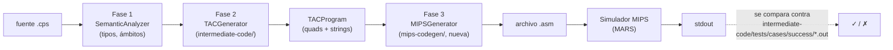
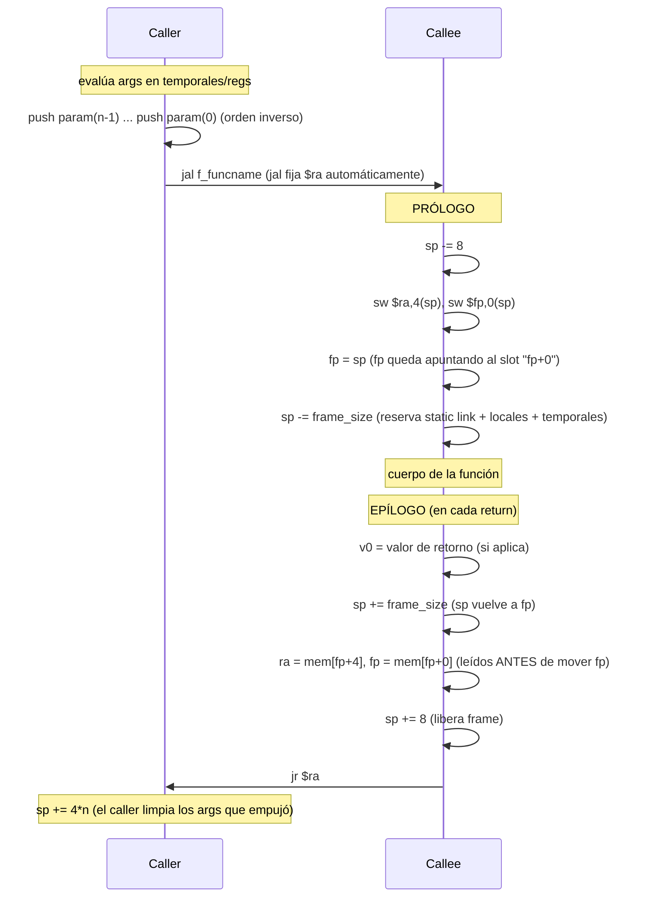
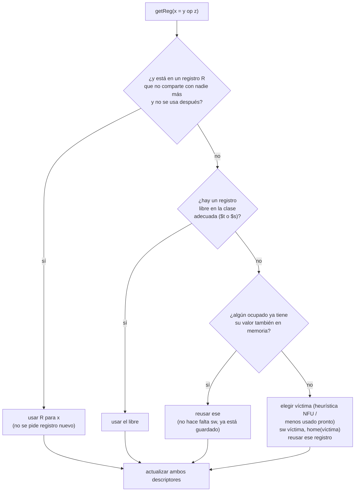
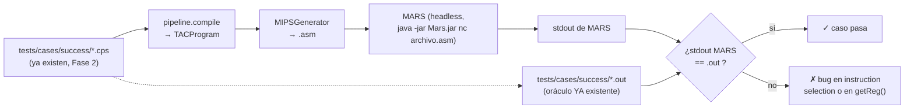

# DISEÑO — Fase 3: Generación de código MIPS

Este documento sustenta el video del Proyecto 3 ([ver video en YouTube](https://youtu.be/66V5c5KZSb0), no listado). Responde a los tres pedidos del enunciado:

1. Secuencias de llamada/retorno (manejo del stack pointer).
2. Asignación de registros (`getReg()`) con spilling a memoria.
3. Generación de ensamblador MIPS ejecutable en un simulador (MARS/SPIM).

No es una propuesta desde cero: la Fase 2 (`intermediate-code/`) ya diseñó el registro de
activación, la tabla de símbolos con offsets y el reciclaje de temporales **pensando en esta
traducción** (`intermediate-code/docs/TAC_LANGUAGE.md` §3, §5, §10). Todo lo que sigue es, en la
medida de lo posible, una traducción mecánica de eso — no un rediseño.

---

## 0. Pipeline extendido



Punto clave para el video: el **oráculo de corrección ya existe**. La Fase 2 tiene un
intérprete de TAC (`ir/interpreter.py`) y archivos `.out` esperados para cada caso de prueba en
`tests/cases/success/`. La Fase 3 no necesita inventar salidas esperadas nuevas: basta con que
MARS, ejecutando el `.asm` generado, imprima **exactamente lo mismo** que ya imprime el
intérprete de Python para el mismo `.tac`. Eso es la validación del ask 3.

El nuevo módulo (`mips-codegen/src/.../mips_codegen/`) recibe un `TACProgram` ya construido —
no vuelve a tocar el árbol de ANTLR ni el análisis semántico. Reutiliza sin cambios:

- `Symbol.address()` / `ActivationRecord` / `GlobalAllocator` (offsets ya calculados).
- `ClassType.field_offsets` / `instance_size` / `vtable` (layout de clases ya calculado).
- `TACProgram.strings` (sección de datos ya deduplicada).
- `TempAllocator.max_used` por función (ya en `TACFunction.frame_size`, ver más abajo).

---

## 1. Ask 1 — Secuencias de llamada y retorno

### 1.1 Mapeo de registros MIPS

| Registro(s) | Uso en este diseño |
|---|---|
| `$fp` (`$s8`) | Puntero de frame — idéntico al `fp` simbólico de la Fase 2 |
| `$sp` | Puntero de pila |
| `$ra` | Dirección de retorno (la escribe `jal`, la salva el **prólogo del callee**) |
| `$v0` | Valor de retorno de la función (`return x` → `move $v0, x`) |
| `$a0` | **Reservado exclusivamente** para pasar el *static link* a una función anidada (ver §1.4). No se usa para argumentos normales — todos los argumentos siguen viajando por la pila, igual que en el TAC de la Fase 2 |
| `$t0–$t9` | Temporales TAC (`Temp`) — ver §2 |
| `$s0–$s7` | Variables "calientes" que sobreviven a una llamada (extensión opcional, ver §2.4) |
| `$gp` | Sección de datos globales — **ya anticipado por el nombre `gp[off]` elegido en la Fase 2** (bonito punto para mencionar en el video: no fue casualidad) |
| `$at`, `$k0`, `$k1` | Reservados por el ensamblador/SO — no se tocan |

### 1.2 Por qué no hay que rediseñar el frame

El layout de la Fase 2 (`TAC_LANGUAGE.md` §3) ya es:

```
          ...
fp + 8+4(n-1)   param n-1
          ...
fp + 8          param 0
fp + 4          dirección de retorno
fp + 0          fp anterior (dynamic link)
fp - 4          static link (reservado siempre)
fp - 8          local 0
          ...
fp - k          temporales
```

y `frame_size = 4 + locales + 4*max_temps` ya está calculado por
`ActivationRecord.finalize()` **en tiempo de compilación**, antes de llegar a esta fase. Eso
significa algo importante para el diseño de MIPS: **no hace falta una pila de evaluación de
operandos en tiempo de ejecución.** Cada temporal TAC ya tiene un offset fijo (su slot de
spill, ver §2) calculado de antemano. El `$sp` de una función solo se mueve dos veces por
invocación (prólogo y epílogo) más lo que empuje cada llamada anidada — nunca dentro del cuerpo
para "hacer espacio" a una subexpresión.

### 1.3 Prólogo / epílogo (función no anidada)



Pseudo-MIPS del prólogo de `f_factorial` (`frame_size` se conoce en tiempo de compilación, sale
de `TACFunction.frame_size`):

```mips
f_factorial:
    addi $sp, $sp, -8
    sw   $ra, 4($sp)
    sw   $fp, 0($sp)
    move $fp, $sp
    addi $sp, $sp, -8          # frame_size de factorial = 8 (ver TAC_LANGUAGE.md §9)
    # ... cuerpo ...
```

Epílogo de un `return x`:

```mips
    lw   $t0, X($fp)           # X = offset de x (local/temp/param)
    move $v0, $t0
    addi $sp, $sp, FRAME_SIZE  # sp = fp  (deshace la reserva de locales/temporales;
                                #           FRAME_SIZE=8 en el caso de factorial)
    lw   $ra, 4($fp)
    lw   $t9, 0($fp)           # fp anterior, a un temporal libre ($t9) ANTES de pisar $fp
    addi $sp, $sp, 8           # sp = fp + 8  (libera los slots de $ra y $fp guardados —
                                #               este +8 es SIEMPRE 8, no depende de la función)
    move $fp, $t9
    jr   $ra
```

**Atención — son dos sumas distintas, no una.** `FRAME_SIZE` (locales+temporales, varía por
función) y el `+8` fijo (los dos words de `$ra`/`$fp` guardados) son pasos separados. Colapsarlos
en uno solo porque en `factorial` ambos "miden 8" es un error fácil de arrastrar al código real:
`$sp` queda corto en cada `return` y se corrompe con la recursión. **Primera versión de este
documento tenía exactamente ese bug** — quede como advertencia para cuando implementen esto de
verdad: escriban un test con recursión profunda (`factorial(10)`) y revisen que `$sp` vuelva a su
valor original al terminar, no solo que el resultado impreso sea correcto.

**Por qué el caller limpia la pila y no el callee:** porque solo el *call site* sabe cuántos
argumentos empujó para esa llamada en particular. El backend emite `addi $sp, $sp,
4*PUSHED` justo después de cada `jal`/`jalr`, donde **`PUSHED` es la cantidad de argumentos que
de verdad fueron a la pila** — **no** necesariamente el `n` crudo que trae el quad `CALL` en su
comentario (`t0 = call f, n`). Ojo con esto: en la Fase 2, cuando la función llamada tiene
*static link*, ese `n` **incluye** el static link como si fuera un argumento más (así lo
interpreta `Interpreter._invoke` en Python, que lo saca de la misma cola de `_pending_params`).
Pero en este diseño el static link viaja por `$a0`, no por la pila (ver §1.4) — así que si el
backend reutilizara ese `n` tal cual para limpiar la pila, limpiaría 4 bytes de más en cada
llamada a una función anidada. La regla correcta es `PUSHED = n - (1 si la función llamada tiene
static link, si no 0)`.

### 1.4 Paso de argumentos y static link (funciones anidadas)

Los argumentos normales se empujan a la pila en **orden inverso** (últim_o primero) para que
`param0` termine exactamente en `fp+8`, tal como ya lo exige el layout de la Fase 2:

```mips
# llamada factorial(n - 1)  ->  TAC: t0 = n-1 ; param t0 ; t0 = call f_factorial, 1
    lw   $t0, N($fp)         # n
    addi $t0, $t0, -1        # t0 = n - 1
    sw   $t0, -4($sp)        # push argumento 0 (único arg -> no hay más que invertir)
    addi $sp, $sp, -4
    jal  f_factorial
    addi $sp, $sp, 4         # el caller limpia 1 argumento (n=1)
    move $t0, $v0            # resultado
```

El *static link* (`up k, off` de la Fase 2, funciones anidadas) **no** se empuja junto con los
argumentos normales — su slot de destino (`fp-4`) vive **adentro** del frame del callee
(offset negativo), no arriba junto a los parámetros, así que no puede ir en la misma secuencia
de `push`. Se pasa en `$a0`, reservado solo para esto:

```mips
# llamada a una función anidada f_outer__r con static link
    # ... aquí van los push de los argumentos normales en orden inverso, si los hay ...
    move $a0, $fp               # (0 saltos) o el resultado de "up k-1, -4" si hay más saltos
    jal  f_outer__r
    addi $sp, $sp, 4*PUSHED     # PUSHED = argumentos normales empujados a la pila;
                                 # NO incluye el static link (ese fue por $a0, no por push)
```

y el prólogo de toda función con `has_static_link=True` agrega una línea:

```mips
f_outer__r:
    addi $sp, $sp, -8
    sw   $ra, 4($sp)
    sw   $fp, 0($sp)
    move $fp, $sp
    sw   $a0, -4($fp)          # guarda el static link recibido
    addi $sp, $sp, -frame_size
```

Un acceso `up k, off` recorre la cadena de static links leyendo `fp-4` repetidamente (`k` veces)
y luego aplica `off` — traducción directa del mismo algoritmo que ya usa
`Interpreter._resolve_static_frame` en Python.

### 1.5 Llamadas a método (`vcall`) — despacho dinámico

`x = vcall obj, slot` (Fase 2, clases) se traduce indexando la vtable en memoria:

```mips
    lw   $t0, 0($obj)          # t0 = puntero a la vtable del objeto
    lw   $t1, SLOT*4($t0)      # t1 = dirección del método (slot resuelto en compile-time)
    jalr $t1                   # llamada indirecta — el target no es una etiqueta fija
```

Cada clase emite su propia tabla en `.data`, generada directamente desde `ClassType.vtable`
(ya calculado en Fase 2, con herencia y *override* resueltos):

```mips
.data
Animal_vtable:  .word Animal_hablar, Animal_comer
Perro_vtable:   .word Perro_hablar,  Animal_comer   # hablar sobrescrito, comer heredado
```

---

## 2. Ask 2 — `getReg()` y asignación de registros

### 2.1 La parte difícil ya la resolvió la Fase 2

Es importante aclarar esto en el video porque es la idea central del diseño: el
`TempAllocator` de la Fase 2 **ya hace análisis de vida** de los temporales TAC (`t0, t1, ...`)
— sabe exactamente cuándo nace y muere cada uno (`new_temp()` / `release()`), y
`max_used` es el pico de temporales simultáneamente vivos en una función completa. Eso es
*liveness analysis* en los hechos, solo que a nivel del TAC, no de MIPS.

Esto simplifica mucho `getReg()` para los `Temp` de la Fase 2:

> Si `max_used <= 10`, cada `t_i` se mapea **de forma fija y directa** a `$t_i` — ni una sola
> decisión en tiempo de generación, cero riesgo de colisión (porque la Fase 2 garantiza que
> nunca hay más de `max_used` temporales vivos a la vez). Si `max_used > 10` (expresiones muy
> grandes, poco común), los temporales `t10, t11, ...` no tienen registro físico: viven
> **siempre** en su slot de pila ya reservado por `frame_size` (`fp - 8 - locales - 4*i`) — ese
> es el "usar el stack para guardar las operaciones" que pide el enunciado.

### 2.2 `getReg()` estilo Dragon Book (para lo que la Fase 2 no resuelve: variables)

Lo que el `TempAllocator` **no** cubre son las variables (`VarRef`: locales, parámetros,
globales) ni la reutilización de registros entre instrucciones distintas. Para eso se
implementa el algoritmo clásico de Aho/Ullman con dos tablas:

- **Descriptor de registro**: por cada `$t`/`$s`, qué variable(s) contiene ahora mismo.
- **Descriptor de dirección**: por cada variable, dónde está su valor vigente (registro,
  memoria, o ambos).



Detalle clave de implementación: **`home(variable)` nunca hay que calcularlo** — ya es
`Symbol.address()` (`fp[-12]`, `gp[4]`, ...) para variables, o el slot de spill del temporal
para `Temp`. El `getReg()` de Fase 3 no inventa direcciones nuevas, solo decide **cuándo**
usar el registro vs. ir directo a esa dirección ya conocida.

### 2.3 Modelo base (el que se implementa primero, siempre correcto)

Para no arriesgar corrección por un `getReg()` demasiado ambicioso, el **modelo base** es
memoria-directa para variables: cada lectura de una `VarRef` hace `lw` a un `$t` libre justo
antes de usarse, cada escritura hace `sw` justo después. Los únicos que de verdad usan registro
"a través de varias instrucciones" son los `Temp` (§2.1), que ya es gratis gracias a la Fase 2.
Esto solo es correcto y ya cumple el ask 2 (hay una función `getReg()`, hay asignación de
`$t`/`$s`, hay spilling a pila cuando no alcanzan los temporales).

### 2.4 Extensión opcional (si da tiempo): variables en `$s`

Promover a `$s0-$s7` una variable local que se lee/escribe muchas veces **dentro de un mismo
bloque básico sin una llamada de por medio** (los `$s` son *callee-saved*, así que sobreviven
una llamada solo si el callee los salva/restaura en su propio prólogo — por eso conviene
reservarlos para variables sin llamadas de por medio, o pagar el costo de salvarlos). Esto es
una optimización, no un requisito — se menciona en el video como "versión avanzada" si el
tiempo lo permite, usando exactamente el mismo `getReg()` de §2.2 pero con la clase de
registro `$s` en vez de `$t`.

### 2.5 Tabla de clases de registro

| Clase | Registros | Para qué | *Caller/Callee-saved* |
|---|---|---|---|
| Temporales TAC | `$t0-$t9` | `Temp` de la Fase 2, mapeo directo (§2.1) | Caller-saved (no sobreviven una llamada; no hace falta salvarlos porque ningún `Temp` sigue vivo después de un `call` — la Fase 2 ya lo garantiza, `switch`/llamadas liberan sus temporales antes) |
| Variables calientes | `$s0-$s7` | Extensión opcional (§2.4) | Callee-saved — quien los usa debe salvarlos en su propio prólogo |
| Retorno | `$v0` | Valor de `return` | — |
| Static link | `$a0` | Solo al llamar una función anidada (§1.4) | — |

---

## 3. Ask 3 — Selección de instrucciones y validación

### 3.1 Tabla de traducción TAC → MIPS (resumen)

| TAC (`OpCode`) | MIPS |
|---|---|
| `ASSIGN x = y` | `lw $t,home(y)` ; `sw $t,home(x)` (o reuso de registro, §2) |
| `ADD/SUB/MUL` | `add/sub/mul` |
| `DIV` | `div $y,$z ; mflo $t` (cociente trunca hacia 0 en enteros, igual que la Fase 2) |
| `MOD` | `div $y,$z ; mfhi $t` |
| `EQ/NE/LT/LE/GT/GE` (como valor) | `seq/sne/slt/sle/sgt/sge` (pseudo-instrucciones de MARS) |
| `NEG` / `NOT` | `sub $t,$zero,$y` / `seq $t,$y,$zero` |
| `GOTO` | `j L` |
| `IF` / `IFFALSE` | `bne $t,$zero,L` / `beq $t,$zero,L` |
| `IF_LT/IF_LE/...` | `blt/ble/bgt/bge/beq/bne` directo (pseudo-ops de MARS) |
| `LABEL` | `L:` |
| `PARAM` / `CALL` | ver §1.3–1.4 |
| `VCALL` | ver §1.5 |
| `RETURN` | ver §1.3 (epílogo) |
| `LOAD x=y[off]` / `STORE y[off]=x` | `lw $t,off($y)` / `sw $t,off($y)` |
| `NEWARRAY` / `NEW` | `syscall 9` (`sbrk`) + inicializar header/campos |
| `LEN` / `BOUNDS` | `lw $t,0($base)` / `blt` + salto a rutina de excepción si falla |
| `CONCAT` / `TOSTR` | llamadas a una mini-rutina en ensamblador (`runtime.asm`, analogía a *libc* mínima) |
| `PRINT` | `syscall 1` (entero) o `syscall 4` (string), según `node_types[ctx]` — la Fase 2 ya guarda ese tipo, no hay que inferirlo de nuevo |
| `TRY_BEGIN/TRY_END/GETEXC/THROW` | bandera global + chequeo explícito tras cada operación riesgosa (MIPS no tiene excepciones de hardware) |
| `UPLOAD/UPSTORE` | cadena de `lw $t,-4($fp)` repetida `k` veces (§1.4) |

### 3.2 Sección de datos

```mips
.data
str_0:          .asciiz "Hola "
globals_base:   .space  <GlobalAllocator.total_size>
Animal_vtable:  .word   Animal_hablar, Animal_comer
Perro_vtable:   .word   Perro_hablar, Animal_comer
.text
.globl main
```

`gp[off]` de la Fase 2 se traduce como `off(globals_base)` — o, más fiel al nombre, cargando
`globals_base` en `$gp` una sola vez al inicio de `main` y usando offsets relativos a `$gp` de
ahí en adelante.

### 3.3 Validación



No hace falta escribir una salida esperada nueva por caso: la Fase 2 ya tiene ~10+ programas
`.cps` con `.out` verificado contra su propio intérprete (`tests/cases/success/`). MARS se
puede correr en modo headless (`java -jar Mars.jar nc archivo.asm`) desde CI, igual que ya corre
`pytest` en `.github/workflows/ci.yml`.

---

## 4. Supuestos de esta fase (declarar en el video)

- Arquitectura MIPS32, simulador MARS (o SPIM si el equipo lo prefiere).
- `$a0` reservado solo para static link — ningún argumento normal lo usa (todo por pila, fiel
  a la convención ya implementada en la Fase 2).
- Modelo base de `getReg()` es memoria-directa para variables + registro fijo para temporales
  (§2.1, §2.3); la versión con descriptor de registro/dirección completo (§2.2/2.4) es la
  extensión "avanzada" si el tiempo alcanza.
- `try/catch` se *emula* con una bandera global, porque MIPS no tiene manejo de excepciones de
  hardware accesible desde ensamblador de usuario.
- `CONCAT`/`TOSTR`/manejo de heap (`NEW`/`NEWARRAY`) necesitan una pequeña rutina de soporte en
  ensamblador (`runtime.asm`) — no son una sola instrucción MIPS.
